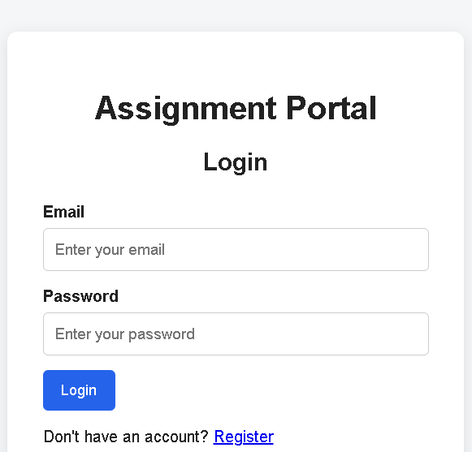
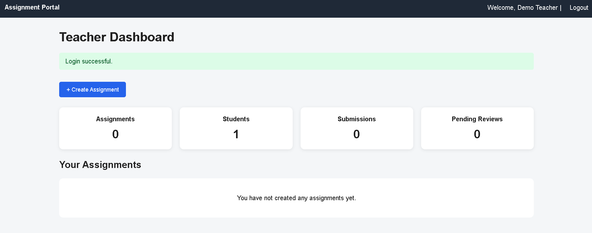
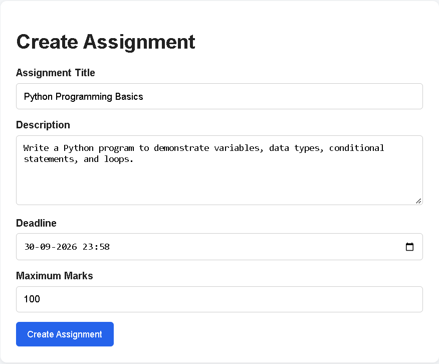
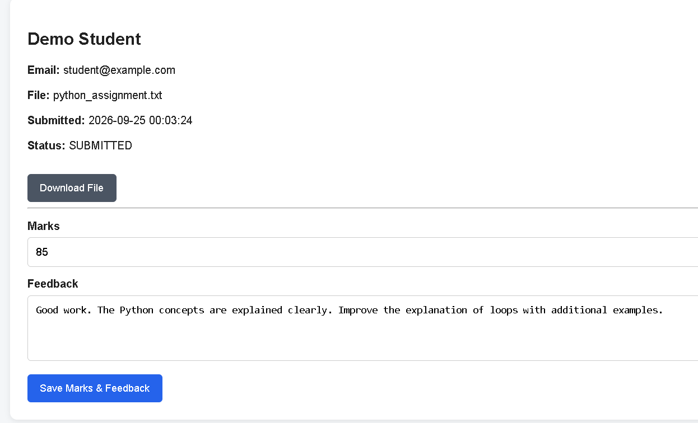
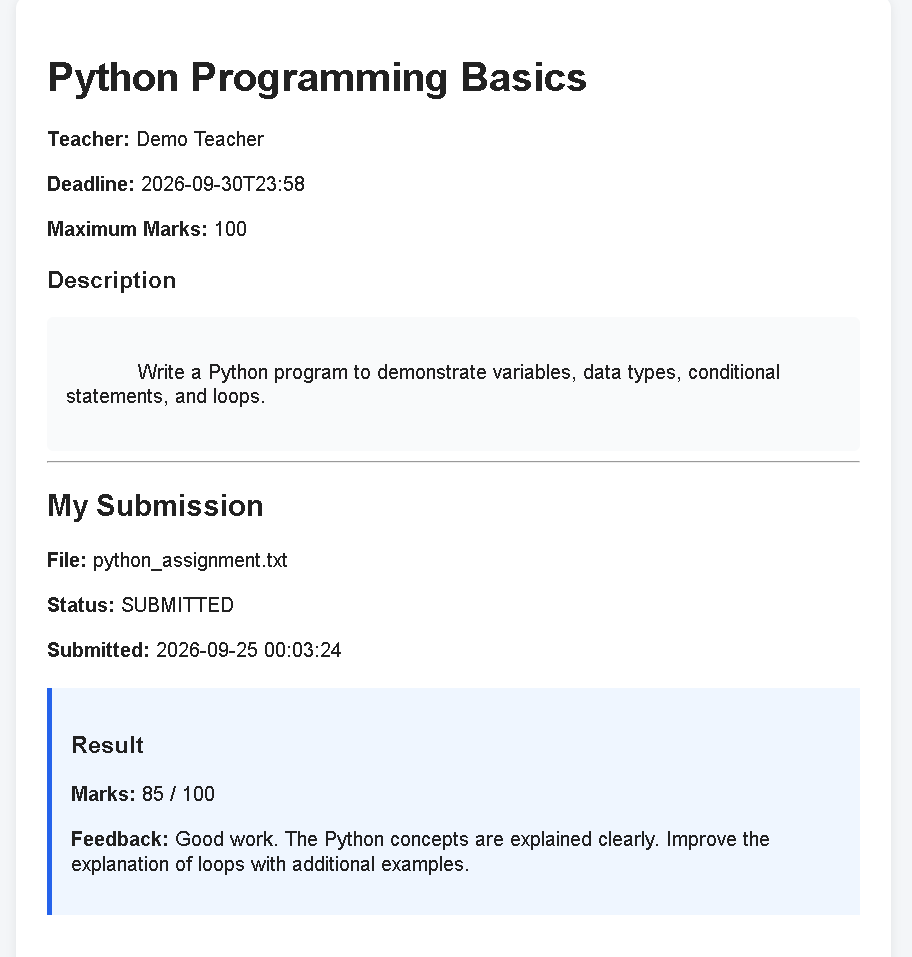

# ☁️ Cloud-Based Student Assignment Submission & Feedback Portal

  
  
  
  
  
  

  

  <strong>A cloud-ready student assignment submission, evaluation, and feedback management platform.</strong>

  Developed as a practical Cloud Computing project using Python, Flask, SQLite, HTML5, CSS3, authentication, role-based access control, file storage, and database management.

---

## 👩‍💻 Author

**Afifa Batool**

**DevOps Lab Mid**

GitHub: https://github.com/batoolafifa

**Credit:** the base portal was taken from the open-source project by **Vayunandan Mishra** (https://github.com/Vayu-143/Cloud-Based-Assignment-Submission-Portal). For the Lab Mid I added the URL validation, automated tests, the GitHub Actions CI pipeline, the local test report receiver and the Gmail test report.

---

## 📌 Project Overview

The **Cloud-Based Student Assignment Submission & Feedback Portal** is a web-based application designed to simplify and centralize the complete assignment lifecycle between students and teachers.

The system provides separate workflows for **Students** and **Teachers**.

Teachers can create assignments, define deadlines, specify maximum marks, view student submissions, download submitted files, evaluate assignments, and provide written feedback.

Students can register and log in, view assignments, submit their work, resubmit assignments, check submission status, download their submitted files, and view marks and teacher feedback.

The current implementation is intentionally simple and beginner-friendly. It uses **Python Flask, SQLite, HTML, CSS, Flask Sessions, password hashing, and local file storage**.

The application is designed with a **cloud-ready architecture**, allowing local components to be replaced later with cloud authentication, managed databases, object storage, cloud hosting, monitoring, and scalable infrastructure.

---

## 🎯 Problem Statement

Traditional assignment management can involve:

- Manual assignment distribution
- Email-based submissions
- Scattered student files
- Difficult submission tracking
- Manual grading records
- Delayed feedback
- Lack of centralized assignment information
- Difficulty maintaining submission history
- Limited accessibility

This project provides a centralized platform where assignment creation, submission, evaluation, file management, and feedback can be handled through a single web application.

---

## 💡 Proposed Solution

The system provides two primary roles.

### 👨‍🏫 Teacher

Teachers can:

- Login securely
- Create assignments
- Add assignment descriptions
- Set assignment deadlines
- Set maximum marks
- View created assignments
- View student submissions
- Download submitted files
- Review student work
- Enter marks
- Provide written feedback
- Track pending reviews

### 👨‍🎓 Student

Students can:

- Register
- Login
- View available assignments
- View assignment details
- Upload assignments
- Resubmit assignments
- View submission status
- Download submitted files
- View marks
- View teacher feedback

---

## 🚀 Key Features

### 🔐 Authentication

- Student registration
- Teacher registration
- Login system
- Logout functionality
- Password hashing
- Session-based authentication
- Protected application routes

### 👥 Role-Based Access Control

The application separates permissions between:

- Student
- Teacher

Students cannot access teacher-only assignment management and grading functions.

Teachers can access assignment creation, submission review, file download, grading, and feedback functions.

### 📝 Assignment Management

Teachers can:

- Create assignments
- Add descriptions
- Set deadlines
- Set maximum marks
- View created assignments

### 📤 Assignment Submission

Students can:

- Select assignments
- Upload assignment files
- View submission status
- Resubmit assignments
- Download their submitted files

### 📥 File Management

The current local implementation stores submitted files inside:

    uploads/

Supported formats:

- PDF
- DOC
- DOCX
- TXT

Maximum upload size:

    5 MB

### ⏰ Deadline Management

The application compares the submission timestamp with the assignment deadline.

Submission status can be:

- SUBMITTED
- LATE

### 📊 Student Dashboard

The Student Dashboard displays:

- Total assignments
- Pending assignments
- Submitted assignments
- Graded assignments
- Assignment list
- Submission status
- Marks
- Feedback

### 📊 Teacher Dashboard

The Teacher Dashboard displays:

- Total assignments
- Total students
- Total submissions
- Pending reviews
- Assignment list
- Submission counts

### 📝 Grading and Feedback

Teachers can:

- View student submissions
- Download submitted files
- Enter marks
- Enter written feedback
- Save evaluation results

Students can then view:

- Submission status
- Marks
- Teacher feedback

---

## 🏗️ System Architecture

    Students / Teachers
            |
            v
    +---------------------+
    | HTML5 + CSS3        |
    | Frontend            |
    +----------+----------+
               |
               v
    +---------------------+
    | Python Flask        |
    | Backend             |
    +----------+----------+
               |
         +-----+-----+
         |           |
         v           v
    +---------+   +-------------+
    | SQLite  |   | Local File  |
    | Database|   | Storage     |
    +---------+   +-------------+
         |              |
         |              |
         v              v
      Users        Assignment Files
      Assignments
      Submissions
      Marks
      Feedback

---

## 🔄 Complete Application Workflow

### Teacher Workflow

    Teacher Login
          |
          v
    Teacher Dashboard
          |
          v
    Create Assignment
          |
          v
    Set Deadline + Maximum Marks
          |
          v
    Assignment Stored in SQLite
          |
          v
    Student Submits Assignment
          |
          v
    Teacher Views Submission
          |
          v
    Download Student File
          |
          v
    Enter Marks + Feedback
          |
          v
    Save Evaluation
          |
          v
    Student Views Result

### Student Workflow

    Student Registration / Login
              |
              v
       Student Dashboard
              |
              v
       View Assignment
              |
              v
       View Deadline
              |
              v
       Upload Assignment
              |
              v
       File Stored Locally
              |
              v
       Submission Metadata Saved
              |
              v
       Teacher Reviews Submission
              |
              v
       Student Views Marks
              |
              v
       Student Views Feedback

---

## ☁️ Cloud Computing Perspective

The current version uses local infrastructure to keep the project simple, understandable, and executable without paid cloud services.

The architecture is designed so that local components can later be replaced with managed cloud services.

| Current Component | Future Cloud Equivalent |
|---|---|
| Flask Application | Cloud-hosted backend |
| SQLite | Managed cloud database |
| uploads/ folder | Cloud object storage |
| Flask Sessions | Managed authentication |
| Localhost | Cloud application hosting |
| Local application logs | Cloud logging |
| Manual deployment | CI/CD pipeline |

---

## ☁️ Future Cloud Architecture

    Students / Teachers
            |
            v
    +---------------------+
    | Frontend Hosting    |
    +----------+----------+
               |
               v
    +---------------------+
    | Authentication      |
    | Service             |
    +----------+----------+
               |
               v
    +---------------------+
    | REST API / Backend  |
    +----------+----------+
               |
          +----+----+
          |         |
          v         v
    +---------+   +----------------+
    | Cloud   |   | Cloud Object   |
    | Database|   | Storage        |
    +---------+   +----------------+
          |              |
          +------+-------+
                 |
                 v
        +------------------+
        | Monitoring and   |
        | Logging          |
        +------------------+

---

## 🧠 Cloud Computing Concepts

### Cloud Computing

The application is designed as a centralized service that can be hosted remotely and accessed through a web browser.

### SaaS

A future cloud deployment can provide the assignment portal as a Software-as-a-Service platform for students and teachers.

### Cloud Database

The current SQLite database can later be migrated to a managed cloud database for:

- User records
- Assignments
- Submission metadata
- Marks
- Feedback

### Object Storage

The current local uploads directory can later be replaced with cloud object storage for:

- PDF files
- DOC files
- DOCX files
- Supporting documents
- Student submissions

### Authentication

The current implementation uses Flask sessions and password hashing.

A future cloud version can use a managed authentication service.

### Authorization

Role-based authorization ensures that students and teachers can access only their permitted functionality.

### Scalability

The application can later separate:

- Frontend
- Backend
- Database
- Object Storage
- Authentication
- Monitoring

This makes it easier to scale individual components independently.

### Availability

Cloud hosting can provide better availability and accessibility than running the application only on a local computer.

### Environment Variables

Sensitive configuration is stored through environment variables instead of hardcoding secrets in the source code.

### Monitoring

A future cloud version can integrate application logs, monitoring dashboards, alerts, and audit information.

---

## 🗄️ Database Design

The current application uses SQLite for local development.

### Users Table

Stores:

- user_id
- name
- email
- password
- role
- created_at

### Assignments Table

Stores:

- assignment_id
- title
- description
- deadline
- max_marks
- created_by
- created_at

### Submissions Table

Stores:

- submission_id
- assignment_id
- student_id
- file_name
- file_path
- submitted_at
- submission_status
- marks
- feedback
- graded_at

### Database Relationship

    Teacher
       |
       | creates
       v
    Assignment
       |
       | receives
       v
    Submission
       |
       | belongs to
       v
    Student

---

## 📁 Project Structure

    Cloud-Based-Assignment-Submission-Portal/
    |
    +-- app.py
    +-- database.py
    +-- run_tests.py            (runs the tests and sends the report)
    +-- report_receiver.py      (receives the report on my laptop)
    +-- requirements.txt
    +-- .env
    +-- .gitignore
    |
    +-- templates/
    |   +-- login.html
    |   +-- register.html
    |   +-- student_dashboard.html
    |   +-- teacher_dashboard.html
    |   +-- create_assignment.html
    |   +-- assignment_details.html
    |   +-- submit_assignment.html
    |   +-- grade_submission.html
    |
    +-- static/
    |   +-- style.css
    |
    +-- uploads/
    |   +-- .gitkeep
    |
    +-- database/
    |   +-- portal.db
    |
    +-- tests/
    |   +-- test_app.py         (3 automated tests)
    |
    +-- .github/workflows/
    |   +-- ci.yml              (GitHub Actions pipeline)
    |
    +-- screenshots/
        +-- assignment-created.png
        +-- login-page.png
        +-- student-result.png
        +-- teacher-dashboard.png
        +-- teacher-grading.png

---

## 🛠️ Technology Stack

### Backend

- Python
- Flask
- Werkzeug
- python-dotenv

### Frontend

- HTML5
- CSS3
- Jinja2 Templates

### Database

- SQLite

### Storage

- Local file storage

### Development Tools

- Visual Studio Code
- Git
- GitHub
- GitHub Actions (CI)
- Cloudflare Tunnel
- Gmail SMTP

### Cloud Concepts

- Cloud Computing
- Cloud Database
- Object Storage
- Authentication
- Authorization
- Role-Based Access Control
- Scalable Architecture
- Cloud Deployment Concepts

---

## 🔐 Security Features

The application includes basic security practices.

### Password Hashing

Passwords are stored using secure password hashing rather than plain-text passwords.

### Authentication

Protected pages require an authenticated user session.

### Role-Based Authorization

Student and teacher functionality is separated.

### Protected Routes

Teacher and student dashboards require appropriate authentication and role permissions.

### File Validation

Uploaded files are checked against supported extensions.

### File Size Validation

Uploaded files are limited to 5 MB.

### Secure File Names

Uploaded files use secure filename handling.

### File Access Control

Students can access only their own submitted files.

Teachers can access submissions associated with assignments they created.

### Environment Variables

Application secrets are configured through `.env`.

Sensitive configuration should not be committed to GitHub.

---

## 📤 File Upload Workflow

    Student selects file
            |
            v
    Validate file extension
            |
            v
    Validate file size
            |
            v
    Generate secure filename
            |
            v
    Save file to uploads/
            |
            v
    Save submission metadata
            |
            v
    Teacher reviews submission
            |
            v
    Teacher downloads file

---

## 🧪 Automated Testing (Lab Mid)

The tests are in `tests/test_app.py`:

| # | Test | What it checks |
|---|---|---|
| 1 | `test_valid_submission_is_saved_and_listed` | A valid submission is saved and appears in the list |
| 2 | `test_missing_registration_number_is_rejected` | A submission with a missing registration number is rejected |
| 3 | `test_invalid_url_is_rejected_and_not_saved` | An invalid submission URL is rejected and not saved |

### Run the tests locally

    pip install -r requirements.txt
    python run_tests.py

This runs the 3 tests and creates `test-report.json`.

---

## ⚙️ CI Pipeline (GitHub Actions)

The pipeline is in `.github/workflows/ci.yml` and runs automatically on every push to `main`.

    git push
       |
       v
    GitHub Actions runner (ubuntu-latest)
       |
       +-- Checkout code, set up Python, install dependencies
       |
       +-- Run tests (run_tests.py)
       |       |
       |       +-- Send test-report.json to my laptop (receiver)
       |
       +-- Email the test report via Gmail (pass and fail)
       |
       +-- Fail the pipeline if any test failed

- If any test fails, the pipeline fails (red).
- The report and the email are sent on both passing and failing runs.

---

## 📥 Receive the Test Report on My Laptop

1. Start the receiver (port 5001):

        python report_receiver.py

2. In a second terminal, start a Cloudflare tunnel:

        cloudflared tunnel --url http://localhost:5001

3. Copy the `https://....trycloudflare.com` address into the `REPORT_RECEIVER_URL` secret.

After every pipeline run, the report is saved on the laptop as `test-report.json`. It contains the repository, branch, commit SHA, pipeline run ID, execution timestamp, every test with its result and failure message, and the total, passed and failed counts.

Note: the quick tunnel address changes every time the tunnel restarts, so update the secret each time.

---

## 📧 Email Test Report (Gmail)

After every run, the pipeline emails the report with `test-report.json` attached. The subject shows the result, for example `DevOps CI Test Report - success` or `DevOps CI Test Report - failure`.

---

## 🔑 Repository Secrets

Settings → Secrets and variables → Actions → Repository secrets

| Secret | Value |
|---|---|
| `REPORT_RECEIVER_URL` | Cloudflare tunnel address |
| `REPORT_TOKEN` | Token sent with the report |
| `EMAIL_ADDRESS` | Gmail address that sends the report |
| `EMAIL_APP_PASSWORD` | Gmail App Password (needs 2-Step Verification) |
| `EMAIL_TO` | Email address that receives the report |

No password or address is written in the code.

---

## 🖥️ Screenshots

### Login Page

### Teacher Dashboard

### Assignment Created

### Teacher Grading

### Student Result

---

## ⚙️ Installation

### 1. Clone the Repository

    git clone https://github.com/batoolafifa/Cloud-Based-Assignment-Submission-Portal.git

### 2. Open the Project

    cd Cloud-Based-Assignment-Submission-Portal

### 3. Create a Virtual Environment

Windows:

    python -m venv .venv

### 4. Activate the Virtual Environment

Windows PowerShell:

    .venv\Scripts\activate

### 5. Install Dependencies

    pip install -r requirements.txt

### 6. Run the Application

    python app.py

### 7. Open the Application

    http://127.0.0.1:5000

---

## 👤 Demo Accounts

### Teacher Account

    Email: teacher@example.com
    Password: teacher123

### Student Account

    Email: student@example.com
    Password: student123

These accounts are intended for local demonstration and testing only.

---

## 📋 Demonstration Workflow

### Step 1

Login as Teacher.

### Step 2

Create an assignment.

Example:

    Title:
    Python Programming Basics

    Maximum Marks:
    100

### Step 3

Logout from the teacher account.

### Step 4

Login as Student.

### Step 5

View the assignment.

### Step 6

Upload an assignment file.

### Step 7

Logout.

### Step 8

Login as Teacher.

### Step 9

Open student submissions.

### Step 10

Download the submitted file.

### Step 11

Enter marks.

Example:

    85 / 100

### Step 12

Enter written feedback.

### Step 13

Save marks and feedback.

### Step 14

Logout and login as Student.

### Step 15

View the final result and teacher feedback.

---

## 📈 Scalability Roadmap

### Small Deployment

    Single Flask Application
            |
            +-- Database
            |
            +-- File Storage

Suitable for:

- Academic demonstration
- Small classroom
- Prototype

### Medium Deployment

    Frontend
       |
       v
    Flask Backend
       |
       +-- Managed Database
       |
       +-- Object Storage

Suitable for:

- Multiple classes
- Multiple teachers
- Hundreds of students

### Larger Deployment

    Users
      |
      v
    Load Balancer
      |
      v
    Multiple Backend Instances
      |
      +-- Managed Database
      |
      +-- Object Storage
      |
      +-- Cache
      |
      +-- Monitoring

This architecture can support substantially larger workloads.

---

## 🔮 Future Enhancements

The following features can be implemented in future versions:

- Cloud database integration
- Cloud object storage
- Managed cloud authentication
- Cloud deployment
- REST API architecture
- Token-based authentication
- Email notifications
- Course management
- Admin dashboard
- Submission analytics
- Assignment search
- Deadline notifications
- Multiple file uploads
- Malware scanning
- Signed/private file URLs
- Audit logging
- Docker containerization
- Automatic deployment (CD)
- Cloud monitoring
- Background task processing
- Auto-scaling infrastructure

---

## 🎓 Learning Outcomes

This project helped develop practical knowledge of:

- Python
- Flask
- Web Application Development
- SQLite
- Database Design
- CRUD Operations
- Authentication
- Authorization
- Role-Based Access Control
- Session Management
- Password Hashing
- File Upload Handling
- File Validation
- Deadline Management
- Grading Systems
- Feedback Management
- Error Handling
- Git
- GitHub
- GitHub Actions (CI)
- Automated Testing
- Cloud Computing Concepts
- Cloud-Ready Architecture
- Object Storage Concepts
- Scalable Application Design

---

## 💼 Industry Relevance

The architecture and workflow of this project are applicable to:

- Learning Management Systems
- University Portals
- School Assignment Platforms
- Online Education Platforms
- Corporate Training Platforms
- Employee Learning Portals
- Online Certification Platforms
- Bootcamp Management Systems
- EdTech Applications

The project demonstrates how authentication, authorization, application logic, databases, file storage, and cloud architecture can work together to create an education technology platform.

---

## 📊 Current Version vs Future Cloud Version

| Component | Current Implementation | Future Cloud Implementation |
|---|---|---|
| Frontend | HTML + CSS | Cloud-hosted frontend |
| Backend | Flask | Cloud-hosted Flask/API |
| Database | SQLite | Managed Cloud Database |
| File Storage | Local uploads/ | Cloud Object Storage |
| Authentication | Flask Sessions | Managed Authentication |
| Deployment | Localhost | Cloud Hosting |
| Monitoring | Local Development | Cloud Monitoring |
| Scaling | Single Application | Scalable Cloud Infrastructure |
| CI | GitHub Actions (automated tests on every push) | Full CI/CD with deployment |

---

## 🏆 Project Highlights

- ✅ Role-Based Student and Teacher Access
- ✅ Secure Login and Registration
- ✅ Password Hashing
- ✅ Assignment Management
- ✅ Deadline Management
- ✅ File Upload and Download
- ✅ Submission Tracking
- ✅ Teacher Grading
- ✅ Written Feedback
- ✅ Student Result Viewing
- ✅ SQLite Database
- ✅ Local File Storage
- ✅ Input Validation
- ✅ Protected Routes
- ✅ Cloud-Ready Architecture
- ✅ GitHub Documentation
- ✅ Automated Tests on Every Push (GitHub Actions)
- ✅ Test Report Delivered to Laptop
- ✅ Email Test Report via Gmail

---

## 🎯 Project Objective

The main objective of this project is to demonstrate practical understanding of **Cloud Computing and web application architecture** by developing a functional assignment management platform and designing it so that local infrastructure can later be migrated to managed cloud services.

The project combines:

    Application Development
            +
    Database Management
            +
    Authentication
            +
    Authorization
            +
    File Storage
            +
    Assignment Management
            +
    Grading and Feedback
            +
    Cloud Architecture

---

## 📫 Links

**GitHub Repository:**  
https://github.com/batoolafifa/Cloud-Based-Assignment-Submission-Portal

**Pipeline Runs:**  
https://github.com/batoolafifa/Cloud-Based-Assignment-Submission-Portal/actions

**Original base project:**  
https://github.com/Vayu-143/Cloud-Based-Assignment-Submission-Portal

---

## 📌 Project Status

**Current Status:** ✅ Completed Local Version

**CI Pipeline:** ✅ Automated tests, local report and email on every push

**Cloud Deployment:** 🔄 Future Enhancement

The current version successfully demonstrates the complete local workflow:

    Teacher
       |
       v
    Create Assignment
       |
       v
    Student
       |
       v
    View Assignment
       |
       v
    Upload Assignment
       |
       v
    Teacher
       |
       v
    Review Submission
       |
       v
    Marks + Feedback
       |
       v
    Student
       |
       v
    View Final Result

---

## 📜 License

This project is developed for educational, academic, learning, and portfolio purposes.

---

  <strong>Built with Python, Flask, SQLite, HTML5 & CSS3 ☁️</strong>

  <strong>Afifa Batool | DevOps Lab Mid</strong>

